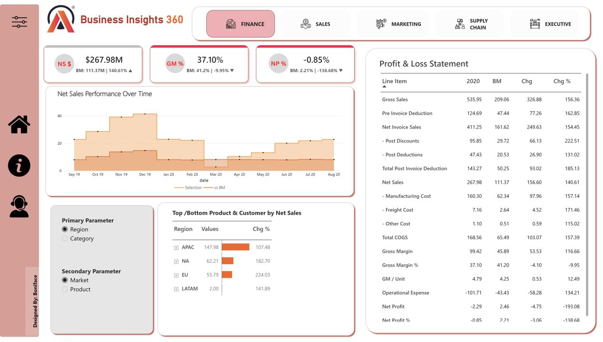

# Business-Intelligence-Analytics-Using-Power-BI
A comprehensive Power BI Business Intelligence project designed to help AtliQ Hardware transform its Excel-based reporting into an integrated, data-driven decision-making solution.

## Problem Statment

AtliQ Hardware has expanded its business across multiple countries, making its business operations and analytical requirements increasingly complex. Despite its rapid growth, the company continues to rely heavily on Excel files for data analysis and reporting.

## Tools and Technologies

- Power BI

[Dashboard](https://app.powerbi.com/view?r=eyJrIjoiYWExYzc0MTAtODU3NS00OTZhLWEwZjEtYzBjNTRjNjViODUwIiwidCI6ImM2ZTU0OWIzLTVmNDUtNDAzMi1hYWU5LWQ0MjQ0ZGM1YjJjNCJ9&pageName=ReportSectiona34025cf011882ba6818)

### 1. 💰 Finance Dashboard

Provides a comprehensive view of the company's financial performance through key financial metrics.

**Key Insights:**
- Profit and Loss (P&L) analysis
- Net Sales performance
- Gross Margin and Gross Margin Percentage
- Net Profit and Net Profit Percentage
- Financial performance trends and comparisons
